<p align="center">
  <a href="https://wijak.org"></a>
</p>

<p align="center">
  <a href="https://wijak.org"></a>
</p>

<p align="center">
  <a href="https://wijak.org"></a>
  <a href="https://www.linkedin.com/in/wijak-manoprang-4a6657318/"></a>
  <a href="mailto:wijak.mano@gmail.com"></a>
  <a href="https://wijak.org/resume.pdf"></a>
  
</p>

---

### `> cat about.md`

```yaml
name:      Wijak Manoprang
role:      Fullstack AI Engineer
based_in:  Bangkok, Thailand 🇹🇭
focus:     [multi-agent systems, RAG, MCP tool orchestration, on-prem LLM serving]
philosophy: "Engineer first, then the model — measured before trusted."
now:       Shipping multi-agent RAG systems to production
```

### `> ./mind-ai --explain`

<p align="center"></p>

### `> ls ~/selected-work`

| Project | What it does | Numbers |
|:--|:--|:--|
| 🏛️ **Mind AI** | Two-chatbot multi-agent RAG for licensing + law advisory, with parallel VLM OCR document checks | In production · 7 laws in parallel |
| 🔧 **Agentic CRM copilot with MCP** | LLM performs CRM actions through MCP tools with validation + controlled execution | Accuracy **71.5% → 83.9%** · retries **−72%** · tool queries **−35%** |
| 💬 **LINE OA sales agent + Text-to-SQL** | Answers FAQs, scores lead intent, alerts sales; real-time CRM dashboard with Text-to-SQL chat | Saves execs hours of meetings / week |
| 🌐 **Autonomous browser agent** | Dual-agent Planner + Navigator that runs web tasks end to end | Extraction → form fill, hands-free |
| 🔍 **On-prem RAG chatbot** | pgvector semantic search + self-hosted Typhoon LLM | No external API |

### `> pip list --tech-stack`

<p align="center">
  
</p>

<p align="center">
  
  
  
  
  
  
  
  
  
  
</p>

### `> git log --stats`

<p align="center">
  
</p>

<p align="center">
  
</p>
